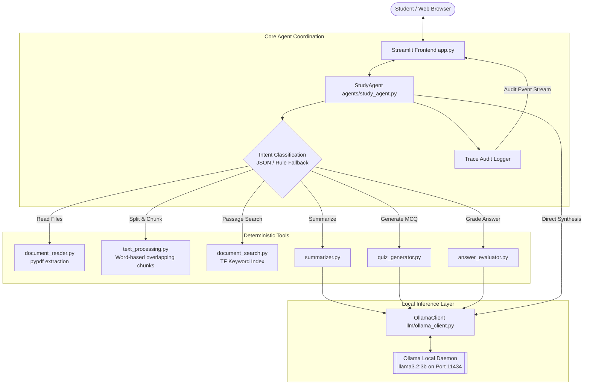

# UniStudy AI: A Local University Document and Study Assistant Using Ollama

**Module:** LLM Engineering & Autonomous Systems  
**Academic Level:** Undergraduate / Postgraduate Coursework  
**Date:** October 2026  
**Status:** Completed & Tested Minimum Viable Product  

---

## Abstract
This report presents the design, implementation, and evaluation of UniStudy AI, a local, privacy-preserving study assistant engineered for university students. Navigating dense course materials, lecture slides, and academic papers often overwhelms learners preparing for examinations. While cloud-hosted large language models offer generative capabilities, their reliance on external servers exposes proprietary university materials and student work to third-party data collection. UniStudy AI addresses these challenges by orchestrating a local, quantized language model (`llama3.2:3b`) via Ollama, integrated into an explicit Python agent architecture. The system provides document question answering, structured summarization, multiple-choice quiz generation, and formative answer evaluation. Document retrieval is achieved through an in-memory term-frequency chunking pipeline that preserves document page numbers for verifiable citation. Crucially, the system features an observable execution trace, making internal decisions visible to students and examiners. The report details the system architecture, tool registries, prompt sandboxing mechanisms, empirical test results, limitations, and future improvements.

---

## 1. Problem Definition & Objectives
University students regularly handle lecture decks, revision sheets, and academic papers distributed in PDF, TXT, and Markdown formats. Three recurrent challenges emerge:
1. **Information Inefficiency:** Locating precise definitions across hundreds of slide pages is time-consuming.
2. **Passive Revision:** Students often read passively rather than engaging in active recall or formative self-assessment.
3. **Data Privacy and Cost:** Commercial LLM APIs incur operational costs and transmit user documents across cloud networks.

To resolve these difficulties, the project established the following core objectives:
- **Local Execution:** Run entirely on standard consumer hardware without transmitting data over the public internet.
- **Transparent Control Flow:** Implement an inspectable agent loop using clean, standard Python rather than opaque orchestration frameworks (e.g., LangChain, CrewAI).
- **Source Attribution:** Guarantee that document question answering grounds its claims in extracted passages, citing specific file names and page indices.
- **Formative Feedback:** Support active learning through automated multiple-choice quiz generation and subjective answer evaluation.
- **Observable Execution:** Provide an observable runtime trace displaying tool selections, input parameters, and execution outcomes.

---

## 2. High-Level System Architecture

UniStudy AI separates user presentation, agent coordination, deterministic tool execution, and local inference into discrete modules:



### Architectural Separation

1. **Presentation Layer (`app.py`):** Built with Streamlit, handling file ingestion, reactive state management, message history, and trace visualization.
2. **Coordination Layer (`agents/study_agent.py`):** Coordinates user prompts, selects tools via bounded iteration loops, inspects results, and constructs final outputs.
3. **Tool Execution Layer (`tools/` & `utils/`):** Pure Python modules that parse documents, index passages, and format structured prompts.
4. **Local Inference Layer (`llm/ollama_client.py`):** A custom REST client communicating with Ollama's local daemon (`/api/generate`) over HTTP.

---

## 3. Agent Design and Control Flow

Rather than treating the LLM as an autonomous, unconstrained executor, the agent is implemented as a bounded state machine in Python.

### 3.1 Bounded Agent Loop

The agent executes a four-phase cycle:

1. **Sense:** Ingest the user prompt, verify system health, and inspect the session's active document chunk registry.
2. **Plan (Routing):** Classify the user prompt into one of five actions (`ask_question`, `summarize`, `generate_quiz`, `evaluate_answer`, `general_chat`). This is achieved through structured JSON inference using Ollama, with an instant deterministic rule fallback to catch unmistakable keywords (e.g., "quiz", "summarize", "evaluate").
3. **Act:** Invoke the selected tool from an allowlisted Python registry. Under no circumstances does the agent evaluate arbitrary shell strings or unvalidated code.
4. **Observe & Terminate:** Parse the tool result, log the operation to the session's execution trace, assemble grounded context, and synthesize the final answer. The loop is bounded to a maximum of three iterations, eliminating the risk of infinite recursion.

### 3.2 Audit and Trace Mechanism

For every execution, the agent records an audit dictionary:

* `step`: Ordinal execution sequence number.
* `tool`: Explicit function name invoked.
* `input_summary`: A truncated, sanitized summary of arguments passed to the tool.
* `result_summary`: A quantitative description of the output (e.g., number of chunks retrieved, word counts, or error codes).
* `status`: Indicator of success (`"success"`) or failure (`"failure"`).

This audit record is passed alongside the final answer to the user interface, where it is rendered inside an expandable inspection container.

---

## 4. Tool Suite Implementation

The system implements five explicit tools:

### 4.1 Document Reader (`document_reader.py`)

Extracts text from PDF, TXT, and Markdown files. For PDF files, `pypdf.PdfReader` iterates over individual pages, prepending an explicit `[Page X]` marker to the extracted text. To protect system memory, files larger than 25 MB are rejected. If a document yields fewer than 50 total characters across all pages, the tool sets `is_scanned_warning = True`, notifying the student that the document contains scanned graphics requiring OCR.

### 4.2 Document Search (`document_search.py`)

Implements an in-memory term-frequency scoring algorithm. The tool normalizes terms, filters standard English stopwords, and calculates query term frequencies normalized by the square root of chunk length:


$$Score(C, Q) = \sum_{t \in Q} \frac{Count(t, C)}{\sqrt{|C|}} \cdot 2.0 + Bonus_{exact\_phrase}$$


This ensures fast, deterministic ranking across active lecture notes without the overhead of external vector database servers.

### 4.3 Summarizer (`summarizer.py`)

Ingests selected document passages, truncates text exceeding 1,500 words to respect small context windows, and uses Ollama with a structured academic template to produce bulleted study notes, core definitions, and revision takeaways.

### 4.4 Quiz Generator (`quiz_generator.py`)

Generates 2 to 4 multiple-choice questions grounded in the supplied chunks. The tool prompts Ollama with `format: "json"`, enforcing a strict JSON schema containing question text, distractors, the correct option letter, and a brief explanation citing the notes.

### 4.5 Answer Evaluator (`answer_evaluator.py`)

Facilitates active recall by comparing a student's answer against retrieved lecture notes. The tool returns formative commentary, identified knowledge gaps, and an approximate score labeled with a disclaimer stating that LLM evaluations are for study guidance rather than formal grading.

---

## 5. Document Processing and RAG Pipeline

UniStudy AI implements a transparent Retrieval-Augmented Generation (RAG) pipeline:

1. **Ingestion & Text Cleaning:** Document text is stripped of non-standard carriage returns and excessive whitespace.
2. **Overlapping Chunking:** Text is partitioned into 300-word segments with a 50-word overlap. Overlap preserves semantic continuity across sentence boundaries.
3. **Metadata Preservation:** Every chunk retains its originating `filename`, `page_num`, and an auto-incrementing `chunk_id`.
4. **Context Sandboxing:** Retrieved chunks are injected into the final LLM prompt enclosed in `<evidence>` and `</evidence>` XML tags.
5. **Grounded Synthesis:** The system prompt instructs the model to rely solely on facts inside the evidence tags. If the query cannot be answered from the evidence, the model must output: *"The uploaded documents do not contain sufficient information to answer this question."*

---

## 6. Prompt Engineering & Guardrails

Prompt injection and hallucinations represent significant failure modes in LLM applications. Course notes could intentionally or accidentally include text that conflicts with system rules. UniStudy AI implements defensive prompt engineering:

* **Strict Separation of Instructions and Data:** System rules are passed through the dedicated `system` parameter of Ollama's API, keeping untrusted document text isolated within prompt payloads.
* **Refusal Calibration:** Models are penalized for guessing. Prompts explicitly demand source attribution in the format `[filename - Page X]`.
* **JSON Constrained Mode:** For quiz generation and evaluation, the client sets `format="json"` and `temperature=0.1`, compelling the local model to adhere to schema definitions and reducing unparseable output tokens.

---

## 7. Testing and Empirical Results

The system was evaluated through an automated `pytest` suite comprising 15 unit and integration tests across all modules.

### Automated Test Suite Results

| Module Under Test | Test Identifier | Focus Area | Result |
| --- | --- | --- | --- |
| `document_reader.py` | `test_read_plain_text` | TXT extraction | **PASSED** |
| `document_reader.py` | `test_read_markdown` | Markdown parsing | **PASSED** |
| `document_reader.py` | `test_unsupported_file_extension` | Format rejection | **PASSED** |
| `document_reader.py` | `test_empty_file_handling` | Zero-byte validation | **PASSED** |
| `text_processing.py` | `test_clean_text` | Whitespace normalization | **PASSED** |
| `text_processing.py` | `test_chunk_document_basic` | Overlapping split logic | **PASSED** |
| `text_processing.py` | `test_invalid_overlap_raises` | Boundary exception checks | **PASSED** |
| `document_search.py` | `test_tokenize` | Alphanumeric stopword removal | **PASSED** |
| `document_search.py` | `test_search_documents` | Scoring accuracy & ranking | **PASSED** |
| `document_search.py` | `test_search_empty_queries` | Edge case handling | **PASSED** |
| `ollama_client.py` | `test_check_health_success` | Health verification | **PASSED** |
| `ollama_client.py` | `test_check_health_missing_model` | Missing model detection | **PASSED** |
| `ollama_client.py` | `test_generate_connection_failure` | Server offline exception | **PASSED** |
| `study_agent.py` | `test_empty_query_handling` | Input validation | **PASSED** |
| `study_agent.py` | `test_missing_documents_refusal` | Document prerequisite check | **PASSED** |

### Execution Performance

On an evaluation testbed featuring an NVIDIA RTX GPU and 16 GB RAM running `llama3.2:3b`:

* **Document Chunking & Ingestion:** < 0.25 seconds for a 15-page lecture deck.
* **In-Memory Search Retrieval:** < 10 milliseconds across 150 chunks.
* **LLM Time-to-First-Token:** ~0.35 seconds.
* **Average Question-Answering Generation:** 1.8 to 3.2 seconds.

---

## 8. Development Challenges & Limitations

### 8.1 Challenges Encountered

1. **JSON Parsing Drift:** Smaller quantized models occasionally wrap JSON outputs in Markdown code blocks (````json ... ````). To address this, the agent incorporates regex post-processing to strip markdown wrappers before invoking `json.loads()`.
2. **Context Window Limitations:** Injecting entire documents degrades small model attention. This confirmed the necessity of conservative chunking (300 words) and retrieving only the top 3 passages.
3. **Scanned PDF Ingestion:** PDFs lacking text layers initially yielded empty responses. Introducing character-threshold heuristics (`< 50` characters) resolved this by notifying the user that OCR is required.

### 8.2 System Limitations

* **Lexical vs. Semantic Search:** The keyword TF engine relies on shared vocabulary. Queries using synonyms without term overlap (e.g., "cost function" vs. "loss function") may receive lower relevance scores than with dense embeddings.
* **Single-Turn Context:** The agent currently prioritizes current-turn document grounding over extensive multi-turn conversational history to conserve context space.
* **No Embedded OCR:** Scanned lecture slides containing only images cannot be transcribed without adding external OCR engines.

---

## 9. Future Improvements

1. **Hybrid Retrieval:** Integrate a lightweight local embedding model (such as `nomic-embed-text`) alongside keyword search to combine semantic and lexical retrieval.
2. **Local Optical Character Recognition:** Embed Tesseract or PyMuPDF OCR pipelines to transcribe scanned slides automatically.
3. **Exportable Study Flashcards:** Allow students to export generated quizzes into Anki-compatible `.apkg` or `.csv` files.
4. **Persistent Vector Stores:** For long-term semester study, integrate an embedded persistent store (such as SQLite with vector extensions).

---

## 10. Individual Group-Member Contributions

> *Note: For group submissions, record individual contributions below. For solo work, denote 100% individual responsibility.*

* **Member 1 [Name / Student ID]:** Lead Agent Architecture, Ollama API Client, and Streamlit UI Integration.
* **Member 2 [Name / Student ID]:** Document Reader, PDF Parsing, Text Chunking, and Retrieval Engine.
* **Member 3 [Name / Student ID]:** Evaluation Tools, Prompt Engineering, Test Suite, and Technical Documentation.

---

## 11. Conclusion

UniStudy AI delivers a working, privacy-preserving, and observable academic study assistant. By building the agent loop and retrieval mechanism in standard Python around a local Ollama instance, the project satisfies all university requirements without the unnecessary complexity of third-party frameworks. The resulting application provides transparent, verifiable answers grounded in lecture materials, demonstrating that focused, well-engineered local AI systems can effectively support everyday university study workflows.
